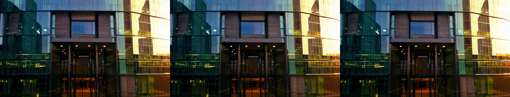

# Wan 2.1 video generation: single-GPU vs multi-GPU benchmark

Containerized text-to-video inference with **Wan 2.1 T2V-1.3B** ([diffusers](https://github.com/huggingface/diffusers)), measured three ways:

| Mode | What it does | Optimizes |
|---|---|---|
| `single` | One GPU renders one video | baseline |
| `dp` (data parallel) | Each GPU renders its own video | throughput (videos/hour) |
| `cp` (context parallel, Ulysses) | All GPUs render one video, splitting the token sequence | latency (time to one video) |

This is a small-scale check of the multi-GPU approach I proposed for an 8-GPU video generation server: a queue of data-parallel workers for throughput, plus sequence parallelism for long high-resolution clips.

## Results

Kaggle, 2× NVIDIA T4 (16 GB, PCIe), fp16, 832×480, 33 frames, 20 steps. torch 2.11.0, diffusers 0.42.0.

| Mode | GPUs | Total, s | Denoise, s | s/step | VAE decode, s | Peak VRAM, GB | Videos/hour |
|---|---|---|---|---|---|---|---|
| single | 1 | 278.6 | 217.2 | 10.86 | ~61 | 4.57 | 12.9 |
| dp | 2 | 298.5 | 230.3 | 11.52 | ~68 | 4.57 | 24.1 |
| cp (Ulysses) | 2 | 188.9 | ~122 | 6.09 | ~67 | 4.57 | 19.1 |

VAE decode = total − denoise. Raw numbers: [`results/*.json`](results), sample videos: [`results/*.mp4`](results).



*Prompt: "A cinematic shot of a modern glass office building at sunset, camera slowly flying towards the entrance, warm light, high detail". Frames 0, 16 and 32.*

| | Throughput vs single | One-video latency vs single | Scaling efficiency |
|---|---|---|---|
| dp ×2 | **1.87×** | 0.93× (7% slower) | 93% |
| cp ×2, end-to-end | 1.48× | **1.47× faster** | 74% |
| cp ×2, denoising only | | **1.78× faster** | 89% |

**Findings:**

- **Data parallel is the throughput workhorse.** Two GPUs give 1.87× more videos per hour with no communication between them. Each video is ~7% slower because both workers share the host CPU, RAM and disk. For a queue of many short jobs, independent per-GPU workers are the right default.
- **Ulysses sequence parallelism works even on T4 over PCIe.** The denoising loop runs 1.78× faster on 2 GPUs (89% efficiency) despite the all-to-all traffic going over PCIe without NVLink.
- **End-to-end speedup is capped by the VAE decode.** The decoder runs on one GPU and takes ~65 s in every mode. It is ~22% of single-GPU time but ~35% of the cp run, so the overall gain drops from 1.78× to 1.47× (Amdahl's law). The next optimization is a parallel or tiled multi-GPU VAE (as in xDiT's DistVAE), or fewer denoising steps via distillation so that decode matters less.
- **Parallelism did not change the output.** The single, dp (rank 0) and cp videos use the same seed and are byte-identical files (same MD5). Ulysses splits attention by heads and the rest of the network works token by token, so the math is the same, just spread over two GPUs. This is a cheap correctness check worth keeping in CI for any parallel setup.
- **Memory is not the bottleneck for the 1.3B model.** With the UMT5-XXL text encoder kept on CPU, the transformer + VAE peak at 4.6 GB of 16 GB. The 14B model in the server design needs ~4× more, which is why that design uses 96 GB GPUs.
- **fp16 on T4 was numerically stable** for this model (no NaN / black frames), with the VAE kept in fp32.

**What this means for the 8-GPU design:** a pool of data-parallel workers for the bulk of jobs, plus a small Ulysses group (degree 2–4) for long, high-resolution clips where one video's latency matters, with parallel VAE decoding to keep that group efficient.

## How it works

- **Memory layout for a 16 GB GPU.** The UMT5-XXL text encoder (~11 GB) runs once on the CPU in bf16 and is then released; only the 1.3B transformer and the VAE live on the GPU. Ranks load one after another so two copies of the text encoder never sit in RAM at once.
- **Precision.** `fp16` on T4 (no fast bf16 on Turing), `bf16` on Ampere and newer. The VAE runs in fp32. The script flags NaN output, the typical sign of fp16 overflow.
- **Timing.** One warmup run, then a measured run with CUDA synchronization; per-step timestamps come from the diffusers step callback. Peak VRAM via `torch.cuda.max_memory_allocated`.
- **Multi-GPU.** Launched with `torchrun` (NCCL). Context parallelism uses diffusers `ContextParallelConfig(ulysses_degree=N)`. Wan 1.3B has 12 attention heads, so Ulysses degree 2, 3, 4 or 6 divides them evenly.

## Run on Kaggle (free, 2× T4)

1. Kaggle → **Create → New Notebook → File → Import Notebook** → `notebooks/kaggle_wan_benchmark.ipynb`.
2. Settings: **Accelerator: GPU T4 x2**, **Internet: On**.
3. **Run All**, then download `results.zip` from the Output panel.

## Run with Docker on a Linux GPU host

Requires the NVIDIA driver and [NVIDIA Container Toolkit](https://docs.nvidia.com/datacenter/cloud-native/container-toolkit/latest/install-guide.html).

```bash
docker build -t wan-video-gpu-benchmark .

# one GPU
docker run --rm --gpus all --shm-size 8g \
  -v hf-cache:/cache -v "$PWD/results:/app/results" \
  wan-video-gpu-benchmark --mode single

# two GPUs, data parallel
docker run --rm --gpus all --shm-size 8g \
  -v hf-cache:/cache -v "$PWD/results:/app/results" \
  --entrypoint torchrun wan-video-gpu-benchmark \
  --nproc_per_node=2 src/bench.py --mode dp

python src/summarize.py results
```

On Ampere or newer GPUs add `--dtype bf16`.

## Build on macOS

macOS has no NVIDIA GPU support in Docker, so the image can be built and inspected but not run:

```bash
docker build --platform linux/amd64 -t wan-video-gpu-benchmark .
docker image ls wan-video-gpu-benchmark
```

## Options

```
--mode single|dp|cp   --dtype fp16|bf16   --height 480 --width 832
--frames 33 (4k+1)    --steps 20          --guidance 5.0
--seed 42             --warmup 1          --prompt "..."
```

## Repository layout

```
src/bench.py                     benchmark (single / dp / cp)
src/summarize.py                 results/*.json -> Markdown table + speedups
notebooks/kaggle_wan_benchmark.ipynb
Dockerfile, docker-compose.yml   container setup
results/                         JSON metrics and sample videos
```

## Limitations

- T4 is a 2018-generation GPU: no fast bf16, no FlashAttention 2, PCIe interconnect. Absolute numbers are far below a modern server; the relative scaling between modes is the point.
- Small model and short clips (33 frames, 480p). Sequence parallelism pays off more on longer, higher-resolution videos, where attention dominates compute.
- One measured run per mode (after one warmup). Run-to-run variance on shared Kaggle machines was not measured.
